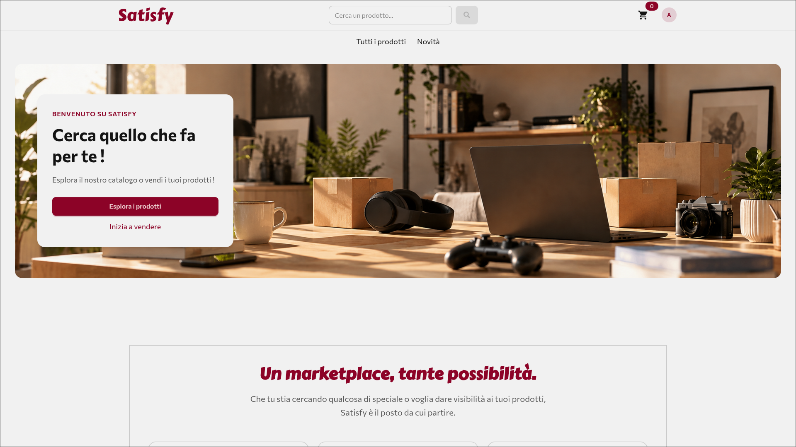
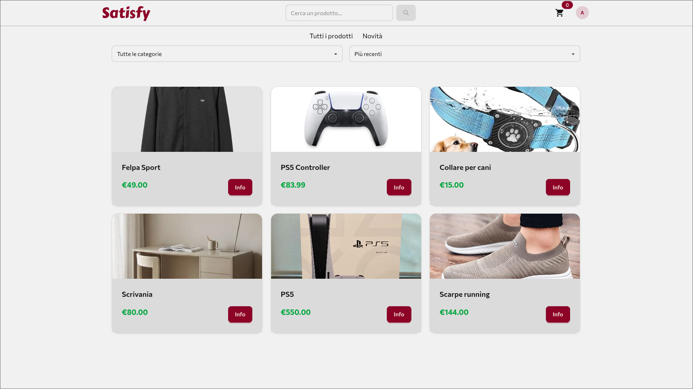
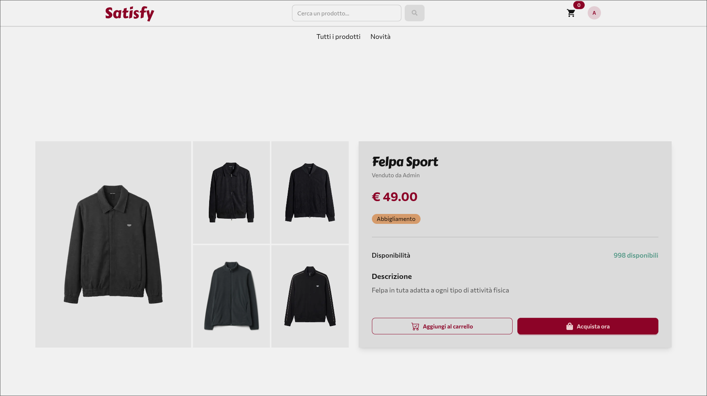
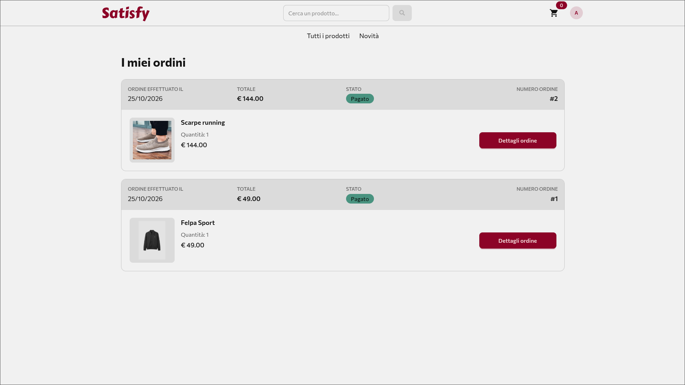
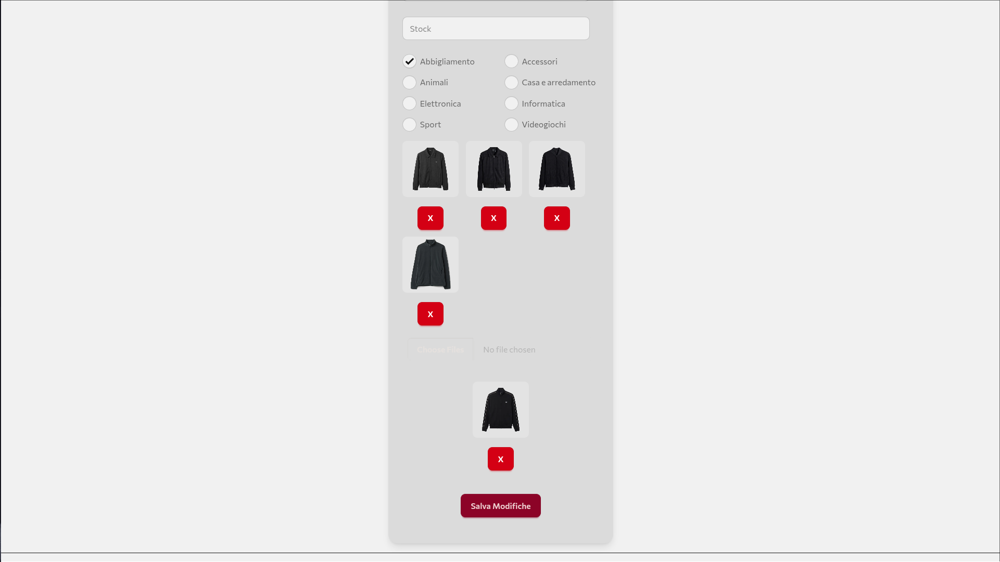

# Satisfy

Satisfy è un piccolo e-commerce in cui gli utenti possono sfogliare, filtrare e acquistare articoli. Ogni utente può anche fare richiesta per diventare venditore e cominciare a vendere e gestire i propri articoli.

🔗 **Demo:** [satisfy-chi.vercel.app](https://satisfy-chi.vercel.app/)
🛠️ **Back end (API Laravel):** [Satisfy_API](https://github.com/RGuacci/Satisfy_API)

> ⏳ L'API è ospitata sul piano gratuito di Render, che la mette in pausa dopo 15 minuti di inattività: al primo accesso potrebbe volerci circa un minuto perché si risvegli.

### Provare la demo

Per provare la creazione e la modifica degli articoli puoi accedere con l'account venditore:

| Email | Password |
|---|---|
| `seller@craftmarket.com` | `password` |

Le richieste per diventare venditore al momento posso approvarle solo io: se vuoi provare il processo completo, contattami su [LinkedIn](https://www.linkedin.com/in/raffaele-guacci).

## Screenshot

### Home
La home di Satisfy: subito sotto la navbar, un header con una breve descrizione di ciò che si può fare sul sito.



### Articoli
La pagina con tutti gli articoli, 12 per pagina, filtrabili per categoria e ordinabili per prezzo. Da qualsiasi punto dell'applicazione si può cercare un articolo per nome con la barra di ricerca nella navbar: basta scrivere e premere invio. Il pulsante **Info** porta al dettaglio di ogni articolo.



### Dettaglio articolo
Tutte le informazioni di un articolo, con le immagini da sfogliare e ingrandire con un click. Gli utenti autenticati possono aggiungerlo al carrello o acquistarlo direttamente.



### Ordini
L'elenco dei propri ordini con il loro stato, da cui si accede alla pagina di dettaglio di ciascuno.



### Modifica articolo
Il caricamento delle immagini: fino a 5 per articolo, con anteprima sia in creazione sia in modifica. In modifica, le immagini già salvate sono separate da quelle nuove, per evidenziare la differenza.



## Stack

- **React 19** + **TypeScript**, con **Vite** come build tool
- **React Router** per la navigazione
- **TanStack Query** per il recupero dei dati dall'API e la gestione della cache
- **Axios** per le chiamate HTTP, configurato per inviare i cookie di sessione
- **React Hook Form** per i form
- **Tailwind CSS** + **daisyUI** per lo stile
- **Motion** per le animazioni
- **React Icons** per le icone

## Avvio in locale

Il front end ha bisogno dell'API per funzionare, quindi per prima cosa avvia il back end seguendo le istruzioni del suo [README](https://github.com/RGuacci/Satisfy_API).

Serve **Node.js** (versione 22 o superiore).

1. Clona il repo:
   ```bash
   git clone https://github.com/RGuacci/Satisfy
   cd Satisfy
   ```
2. Installa le dipendenze:
   ```bash
   npm install
   ```
3. Avvia il server di sviluppo:
   ```bash
   npm run dev
   ```

L'app sarà disponibile su `http://localhost:5173`. Non serve configurare nessun file `.env`: il server di sviluppo di Vite inoltra in automatico le richieste all'API su `http://localhost:8000`.

<!-- da completare dopo lo studio: come comunica con l'API in produzione (rewrites di Vercel) -->

